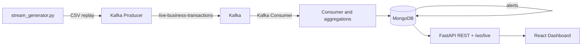

# PulseBI - Real-Time Business Intelligence Platform

PulseBI is a local real-time analytics dashboard with Kafka ingestion, MongoDB aggregation, XGBoost forecasting, FastAPI REST/WebSocket endpoints, and a React frontend.

> **Honest data statement:** PulseBI uses a simulated real-time stream that replays the public Kaggle dataset **E-Commerce Shipping Data (Customer Analytics)**: <https://www.kaggle.com/datasets/prachi13/customer-analytics>. The CSV contains 10,999 rows and is replayed in a loop at 1 row per second. `backend/seed_db.py` backfills 30 days of hourly/daily data by sampling real CSV rows and applying the same aggregation helpers as the live consumer. `train_model.py` then creates historical walk-forward backtest predictions.

## Architecture



The producer sends JSON events from `backend/data/business_dataset.csv` to the `live-business-transactions` Kafka topic. The consumer cleans each event, stores raw transactions, and atomically updates hourly and daily MongoDB aggregates. FastAPI exposes REST endpoints and broadcasts MongoDB changes over `/ws/live`. The React dashboard polls REST endpoints and also receives WebSocket events.

## Repository Structure

```text
Real-Time-Business-Analytics-Platform/
├── backend/
│   ├── kafka_producer.py
│   ├── kafka_consumer.py
│   ├── stream_generator.py
│   ├── seed_db.py
│   ├── database.py
│   ├── kpi_calculator.py
│   ├── data/
│   │   └── business_dataset.csv
│   ├── analytics_ml/
│   │   ├── train_model.py
│   │   ├── forecast_engine.py
│   │   ├── metrics.py
│   │   └── models/
│   │       ├── sales_model.pkl
│   │       └── metrics.json
│   ├── api_server/
│   │   ├── server.py
│   │   ├── db.py
│   │   └── routes/
│   │       ├── historical.py
│   │       ├── predictions.py
│   │       └── alerts.py
│   └── tests/
├── frontend/
│   ├── src/
│   │   ├── pages/
│   │   ├── components/
│   │   └── services/
│   └── package.json
├── docker-compose.yml
└── README.md
```

## Pages

The React app has three routes:

| Route | Page | Current behavior |
|---|---|---|
| `/` | Live Dashboard | KPI cards, revenue, shipment, warehouse, forecast, transaction table, live alerts |
| `/analytics` | Analytics | Daily revenue, operations radar, hourly revenue/order trends, and historical tables |
| `/predictions` | ML Predictions | Model/baseline metric cards, prediction chart/history, and prediction log |

### Screenshots

No PNG files currently exist in `docs/screenshots/`, so no dashboard screenshots are embedded. This README does not use fabricated or external screenshot images.

## Dataset

- **Dataset:** E-Commerce Shipping Data (Customer Analytics)
- **Source:** <https://www.kaggle.com/datasets/prachi13/customer-analytics>
- **Local CSV:** `backend/data/business_dataset.csv`
- **Rows:** 10,999 data rows plus one header
- **Replay behavior:** `stream_generator.py` reads the CSV, yields each row as JSON, and repeats the loop with a 1-second delay
- **Hourly volume:** `EVENTS_PER_HOUR=3600` matches the live 1-row-per-second replay. The 30-day seed backfill creates 720 hourly aggregates at this volume.
- **Main columns:** `ID`, `Warehouse_block`, `Mode_of_Shipment`, `Customer_care_calls`, `Customer_rating`, `Cost_of_the_Product`, `Prior_purchases`, `Product_importance`, `Gender`, `Discount_offered`, `Weight_in_gms`, `Reached.on.Time_Y.N`

The replay assigns the CSV `ID` value from the `ID` column. Only `timestamp` is generated for the live stream event.

## Kafka, MongoDB, and Alerts

- Kafka broker: `localhost:9092`
- Kafka topic: `live-business-transactions`
- Producer: `backend/kafka_producer.py`
- Consumer: `backend/kafka_consumer.py`
- MongoDB: `localhost:27017`
- MongoDB database: `stream_analytics`
- Collections:
  - `transactions`
  - `hourly_metrics`
  - `daily_metrics`
  - `predictions`
  - `alerts`

Hourly and daily metrics are created/updated in `backend/database.py` with MongoDB upserts. The Kafka consumer stores a `source: "stream"` field on streamed transactions and metric documents.

Hourly operational alert rules in `backend/database.py` fire only once for a target hour/rule pair:

- On-time delivery below 65%
- Hourly revenue drop greater than 40% compared with the previous completed hour

The frontend also keeps a separate prediction-spike rule: a prediction change greater than 25% from the previous prediction creates a `"Prediction spike"` alert.

## XGBoost Forecasting

The model predicts `total_cost` for the next hour.

Features used:

- `total_transactions`
- `avg_discount`
- `avg_rating`
- `total_weight`
- `hour`
- `day_of_week`
- `day_of_month`
- `is_weekend`
- `lag_1h`
- `lag_2h`
- `lag_3h`
- `rolling_3h_mean`

Training uses all available documents in `hourly_metrics`, sorted by timestamp, then uses an 80/20 time-ordered split without shuffling. The model is an `XGBRegressor` and is saved as `backend/analytics_ml/models/sales_model.pkl` together with its feature list.

`backend/analytics_ml/train_model.py` writes `backend/analytics_ml/models/metrics.json`. The checked-in offline metrics were produced from 573 training rows and 144 test rows (`n=144`) over the date range `2026-10-21T18:00:00` to `2026-11-20T14:00:00`:

| Metric | XGBoost | Previous hour | Mean 24h |
|---|---:|---:|---:|
| MAE | 2562.4735 | 3200.0694 | 2574.4201 |
| RMSE | 3180.6598 | 3996.6639 | 3105.8231 |
| MAPE | 0.3386% | 0.4228% | 0.3402% |
| R2 | Not calculated | Not calculated | Not calculated |

Backtest population: `n=144` completed next-hour targets. The model beats the previous-hour baseline on MAE/RMSE/MAPE, but mean-24h has lower RMSE and near-equal MAPE/MAE.

Offline test-set metrics (secondary, 572 training / 144 test):

| Metric | XGBoost | Previous hour | Mean 24h |
|---|---:|---:|---:|
| MAE | 2642.0972 | 3637.3958 | 2574.4201 |
| RMSE | 3244.9278 | 4486.8549 | 3105.8231 |
| MAPE | 0.3492% | 0.4806% | 0.3402% |
| R2 | -0.1618 | Not calculated | Not calculated |

Hourly revenue is nearly constant because each seeded hour contains 3,600 sampled
CSV rows. The observed hourly changes are typically about +/-0.4%, so forecasting
skill is not a real-world claim.

The naive baseline predicts that next-hour revenue equals the previous completed hour's `total_cost`. Live matched metrics are available from `GET /api/predictions/evaluation`.

Training and backtest use leak-free next-hour alignment: for row hour `t`, the
target is `total_cost(t+1)` and only metrics from `t` and earlier are features.
The target hour calendar fields come from `t+1`. Cost lags and rolling features
are shifted so they do not include the target hour.

## Technology Stack

### Frontend

| Library | Version |
|---|---|
| React | 18.2.0 |
| React DOM | 18.2.0 |
| React Router DOM | 7.17.0 |
| Vite | 5.1.0 |
| Recharts | 3.8.1 |
| Axios | 1.17.0 |

### Backend

| Library | Pinned version |
|---|---|
| FastAPI | 0.165.0 |
| Uvicorn | 0.54.0 |
| PyMongo | 4.20.1 |
| python-dotenv | 1.0.1 |
| kafka-python-ng | 2.2.3 |
| pandas | 3.1.1 |
| NumPy | 2.5.5 |
| XGBoost | 3.4.1 |
| scikit-learn | 1.9.1 |
| Joblib | 1.6.0 |
| pytest | 9.2.0 |

Docker Compose runs Apache Kafka and MongoDB 7.

### API and WebSocket

- REST API base URL: `http://localhost:8000`
- WebSocket: `ws://localhost:8000/ws/live`
- Historical endpoints: `/api/historical-data`, `/api/hourly-metrics`, `/api/daily-metrics`
- Prediction endpoints: `/api/predictions/`, `/api/predictions/latest`, `/api/predictions/evaluation`
- Alert endpoint: `/api/alerts`
- Health endpoint: `/api/health`

The exact default API port is 8000. If Windows blocks that port, Uvicorn can be started on another available port, for example 18080, and the frontend must receive matching `VITE_API_URL` and `VITE_WS_URL` environment variables.

## Setup

### Prerequisites

- Python 3.9 or newer
- Node.js and npm
- Docker Desktop or Docker Engine

### 1. Clone

```bash
git clone https://github.com/emeshika/Real-Time-Business-Analytics-Platform.git
cd Real-Time-Business-Analytics-Platform
```

### 2. Start Kafka and MongoDB

```bash
docker compose up -d
docker compose ps
```

This starts Kafka on `9092` and MongoDB on `27017`.

### 3. Configure the backend

```bash
cd backend
python -m venv venv
```

Windows:

```powershell
.\venv\Scripts\Activate.ps1
pip install -r requirements.txt
Copy-Item .env.example .env
```

macOS/Linux:

```bash
source venv/bin/activate
pip install -r requirements.txt
cp .env.example .env
```

### 4. Seed initial dashboard data

Run from `backend/`:

```bash
python seed_db.py
```

This creates 30 days of hourly/daily history from real CSV rows and clears/recreates the transactions collection with source `"seed_csv"`. Run `train_model.py` afterward to create model backtest predictions with source `"backtest"`; the running forecast engine creates source `"stream"` predictions.

### 5. Train the model

```bash
python analytics_ml/train_model.py
```

This requires MongoDB and non-empty `hourly_metrics`, and writes both `analytics_ml/models/sales_model.pkl` and `analytics_ml/models/metrics.json`.

### 6. Start the Kafka pipeline

Terminal 1:

```bash
cd backend
python kafka_producer.py
```

Terminal 2:

```bash
cd backend
python kafka_consumer.py
```

The producer continuously sends CSV rows. The consumer stores raw events and updates hourly/daily aggregates.

### 7. Start prediction generation

In an additional backend terminal:

```bash
cd backend
python analytics_ml/forecast_engine.py
```

It loads `sales_model.pkl` and writes one forecast to MongoDB every 30 seconds.

### 8. Start the API

```bash
cd backend
uvicorn api_server.server:app --reload --host 0.0.0.0 --port 8000
```

Health check:

```text
http://localhost:8000/api/health
```

### 9. Start the React dashboard

In a separate terminal:

```bash
cd frontend
npm install
npm run dev
```

Open the Vite URL shown in the terminal, normally:

```text
http://localhost:5173
```

### 10. Run tests

```bash
cd backend
python -m pytest tests -q
```

## Team and Module Allocation

Team lead: **Hirushi Emeshika**

| Module | Allocation |
|---|---|
| Data generation and stream replay | Data Streaming Couple 01 |
| Kafka producer/consumer pipeline | Data Streaming Couple 02 |
| KPI calculation and ML forecasting | Analytics/ML Couple 03 |
| FastAPI REST and WebSocket server | API Server Couple 04 |
| React dashboard | Frontend Couple 05 |

## Limitations

- The public Kaggle shipping CSV is a shuffled shipping dataset, not a naturally ordered hourly time series. PulseBI adds timestamps only for replay/backfill; forecast skill is not expected as a real-world claim.
- Live replay timestamps, seeded hourly timestamps, and seeded prediction timestamps determine the chart timeline.
- `forecast_engine.py` predicts `total_cost` from hourly aggregates, but the dataset and seed history are limited for a strong forecasting evaluation.
- Metrics are compared against a simple previous-hour naive baseline.
- Backend operational alerts are rule-based and are not a full anomaly detection platform.
- MongoDB seed transactions, hourly metrics, and daily metrics are sampled from the real CSV rather than invented random values. Rerunning the seed script replaces the seeded collections.
- No automated browser test suite or screenshot set is currently stored in the repository.
