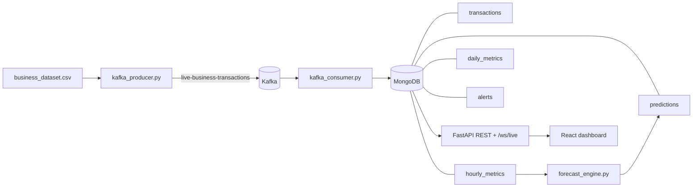

# PulseBI - Real-Time Business Analytics Platform

PulseBI is a simulated real-time analytics platform. A public shipping dataset is streamed through **Kafka** into **MongoDB**, aggregated into hourly and daily metrics, forecast with **XGBoost**, served by a **FastAPI** REST + WebSocket API and shown on a live **React** dashboard.

> **Honest data statement.** The stream is a *simulation*. It replays the public Kaggle dataset **E-Commerce Shipping Data (Customer Analytics)** (<https://www.kaggle.com/datasets/prachi13/customer-analytics>), 10,999 rows, in shuffled order at 1 row per second. Thirty days of hourly/daily history are backfilled by `backend/seed_db.py` from sampled CSV rows through the same aggregation code the live consumer uses. "Revenue" in the dashboard means the total `Cost_of_the_Product` (USD).

## Screenshots

| Live dashboard | Analytics |
|---|---|
|  |  |

| ML predictions and evaluation | Alerts |
|---|---|
|  |  |

Live transactions (stream events with their source and event time):


## Architecture



1. **Producer** sends one CSV row per second (shuffled each loop) to the `live-business-transactions` topic.
2. **Consumer** cleans each event, stores it and atomically updates the hourly and daily aggregates in MongoDB. After an hour finishes it evaluates the alert rules for that completed hour.
3. **Forecast engine** predicts the revenue of the next hour once per target hour.
4. **FastAPI** serves REST endpoints and pushes new transactions, predictions and alerts over `/ws/live`.
5. **React dashboard** polls the REST API and listens to the WebSocket.

## How the forecast works

* **Task:** for a complete hour `t`, predict `total_cost` of hour `t+1`.
* **Complete hours only.** An hour counts only if it holds at least 95% of the expected 3,600 events (`EVENTS_PER_HOUR`). Hours where the stream started or stopped mid-hour are excluded from training, testing and evaluation, and the exclusion count is stored in `metrics.json`.
* **No leakage.** Every feature uses data from hour `t` or earlier. Calendar features describe the target hour, which is known in advance. Training and live serving share one feature module (`analytics_ml/features.py`).
* **Features:** `total_transactions`, `avg_discount`, `avg_rating`, `total_weight`, `hour`, `day_of_week`, `day_of_month`, `is_weekend`, `lag_0h`, `lag_1h`, `lag_2h`, `lag_3h`, `rolling_3h_mean`.
* **Baselines** (same information the model has): *naive* (next hour = this hour) and *mean 24h* (mean of the last 24 hours).
* **Three separate evaluations, never mixed:**
  * **Offline test:** time-ordered 80/20 split.
  * **Walk-forward backtest:** the model is re-fitted before every test hour.
  * **Stream:** live predictions are scored after their target hour has finished and only if that hour is complete.
* One prediction is stored per target hour. The Prediction Log shows the actual revenue and error once the hour is complete.

## Results

Numbers below come from `backend/analytics_ml/models/metrics.json` (run of 2026-11-24, n = 142 test hours). Errors are in USD per hour; lower is better. Re-running `seed_db.py` and `train_model.py` produces slightly different values (`python analytics_ml/print_metrics_tables.py` prints the table from `metrics.json`).

| Metric | XGBoost | Naive (previous hour) | Mean 24h |
|---|---:|---:|---:|
| MAE (offline test) | $2,616 | $3,649 | $2,578 |
| RMSE (offline test) | $3,279 | $4,506 | $3,113 |
| MAPE (offline test) | 0.35% | 0.48% | 0.34% |
| MAE (walk-forward backtest) | $2,604 | $3,649 | $2,578 |
| RMSE (walk-forward backtest) | $3,196 | $4,506 | $3,113 |
| MAPE (walk-forward backtest) | 0.34% | 0.48% | 0.34% |

**Reading the results honestly:** the model has about 28% lower MAE than the naive baseline (backtest: $2,604 vs $3,649), but it is not better than a plain 24-hour mean (about 1% higher MAE: $2,604 vs $2,578). Each hour of the simulation contains 3,600 sampled CSV rows, so hourly revenue is almost constant (about +/-0.4%) and there is no real time pattern to learn. The low MAPE therefore says little on its own; the baselines are what matter. An earlier version of the model looked much better because of target leakage; fixing it and adding a walk-forward backtest with baselines gave the numbers above.

**Stream metrics** (live predictions scored after their hour finished) appear on the Predictions page and in `GET /api/predictions/evaluation`. They are labelled "too few to conclude" until at least 20 hours have been scored.

## Alerts

Rule-based, computed by the consumer for the **last completed hour** (never the hour in progress), at most once per hour and rule:

* On-time delivery below 65%.
* Hourly revenue down more than 40% versus the previous completed hour.

The dashboard also raises a "Prediction spike" alert when a new prediction differs by more than 25% from the previous one. In this dataset only about 40% of orders arrive on time, so the first rule fires every hour; it demonstrates the alert pipeline, not a real incident.

## Dataset

* **Source:** Kaggle, E-Commerce Shipping Data (Customer Analytics).
* **File:** `backend/data/business_dataset.csv`, 10,999 data rows.
* **Columns:** `ID`, `Warehouse_block`, `Mode_of_Shipment`, `Customer_care_calls`, `Customer_rating`, `Cost_of_the_Product`, `Prior_purchases`, `Product_importance`, `Gender`, `Discount_offered`, `Weight_in_gms`, `Reached.on.Time_Y.N`.
* In the Kaggle file `Reached.on.Time_Y.N = 1` means the order did **not** arrive on time. One shared mapping (`backend/data_mapping.py`) is used by the seed script, producer and consumer.

## Repository structure

```text
Real-Time-Business-Analytics-Platform/
├── backend/
│   ├── kafka_producer.py        # CSV replay to Kafka
│   ├── kafka_consumer.py        # cleaning, aggregation, alerts
│   ├── stream_generator.py
│   ├── seed_db.py               # 30-day backfill from sampled CSV rows
│   ├── database.py              # aggregation helpers and alert rules
│   ├── config.py                # EVENTS_PER_HOUR, completeness rule
│   ├── data_mapping.py
│   ├── data/business_dataset.csv
│   ├── analytics_ml/
│   │   ├── features.py          # shared feature engineering
│   │   ├── train_model.py       # training, offline test, backtest
│   │   ├── forecast_engine.py   # live predictions
│   │   ├── metrics.py
│   │   └── models/              # sales_model.pkl, metrics.json
│   ├── api_server/              # FastAPI app, routes, WebSocket
│   └── tests/
├── frontend/                    # React 18 + Vite dashboard
├── docs/screenshots/
├── docker-compose.yml           # Kafka + MongoDB
└── README.md
```

## Technology stack

| Area | Technology |
|---|---|
| Streaming | Apache Kafka (Docker), kafka-python-ng |
| Storage | MongoDB 7 (Docker), PyMongo |
| ML | XGBoost, scikit-learn, pandas, NumPy, joblib |
| API | FastAPI, Uvicorn, WebSockets |
| Frontend | React 18, React Router, Vite, Recharts, Axios |
| Testing | pytest |

Exact versions are pinned in `backend/requirements.txt`, `backend/api_server/requirements.txt` and `frontend/package.json`.

## Setup

### Prerequisites

Python 3.9+, Node.js and npm, Docker Desktop or Docker Engine.

### 1. Clone and start Kafka + MongoDB

```bash
git clone https://github.com/emeshika/Real-Time-Business-Analytics-Platform.git
cd Real-Time-Business-Analytics-Platform
docker compose up -d
```

### 2. Backend environment

```bash
cd backend
python -m venv venv
```

Windows: `.\venv\Scripts\Activate.ps1` · macOS/Linux: `source venv/bin/activate`

```bash
pip install -r requirements.txt
cp .env.example .env      # Windows: Copy-Item .env.example .env
```

`.env` is never committed. The default MongoDB URI is `mongodb://localhost:27017`. Optional variable: `EVENTS_PER_HOUR` (default 3600).

### 3. Seed history and train (once)

```bash
python seed_db.py
python analytics_ml/train_model.py
```

> Re-running `seed_db.py` recreates the collections, including `predictions`, so always run `train_model.py` again afterwards.

### 4. Start the live pipeline (one terminal each, from `backend/`)

```bash
python kafka_consumer.py
python kafka_producer.py
python analytics_ml/forecast_engine.py
uvicorn api_server.server:app --host 0.0.0.0 --port 8000
```

If Windows blocks port 8000 (WinError 10013), use another port such as 18080 and create `frontend/.env.local`:

```text
VITE_API_URL=http://localhost:18080
VITE_WS_URL=ws://localhost:18080/ws/live
```

### 5. Start the dashboard

```bash
cd frontend
npm install
npm run dev
```

Open <http://localhost:5173>. Health check: `/api/health` on the API port.

### 6. Tests

```bash
cd backend
python -m pytest tests -q
```

## API

| Endpoint | Description |
|---|---|
| `GET /api/hourly-metrics`, `/api/daily-metrics`, `/api/historical-data` | Aggregates and recent transactions |
| `GET /api/predictions/`, `/api/predictions/latest` | Predictions (newest first) |
| `GET /api/predictions/evaluation` | Offline, backtest and stream metrics |
| `GET /api/alerts` | Recent alerts |
| `WS /ws/live` | Pushes `new_transaction`, `new_prediction`, `new_alert` |

## Team and module allocation

Team lead: **Hirushi Emeshika** (module split, Git workflow, integration, testing and handover).

| Module | Allocation |
|---|---|
| Data generation and stream replay | Data Streaming Couple 01 |
| Kafka producer/consumer pipeline | Data Streaming Couple 02 |
| KPI calculation and ML forecasting | Analytics/ML Couple 03 |
| FastAPI REST and WebSocket server | API Server Couple 04 |
| React dashboard | Frontend Couple 05 |

## Limitations

* The stream and the history are simulated from a shipping dataset that has no natural time order, so hourly revenue is nearly constant and forecasting skill is not a real-world claim.
* The model does not beat a plain 24-hour mean; live (stream) metrics need many completed hours before they are meaningful and are labelled "too few to conclude" until n >= 20.
* An hour in which the stream (re)starts mid-hour is incomplete and is skipped. After such a gap, four consecutive complete hours are needed before live predictions resume (the model uses lags up to three hours).
* Alerts are simple rules, not an anomaly-detection system.
* No authentication; CORS is open for local development. Database credentials come from environment variables only.
* No browser-level automated tests.